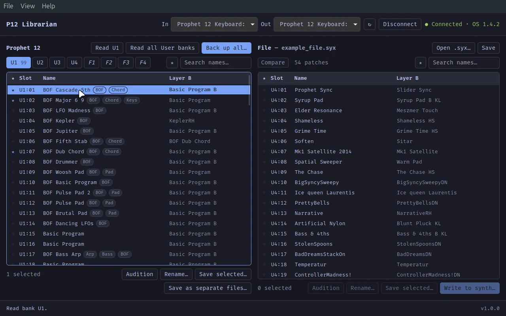

# P12 Librarian

A patch librarian for the Sequential (Dave Smith Instruments) Prophet 12.

Back up, browse, search, rename and rearrange the programs on a Prophet 12 over MIDI SysEx, compare
the synth with a backup and edit `.syx` files. Every write to the synth is backed up first and
verified afterwards, and can be undone. Runs on Linux and Windows and works offline. There is no
macOS release, but it builds on macOS from source ([docs/macos.md](docs/macos.md)).

[](https://qutrit.se/assets/p12-showcase.mp4)

*Click the picture for a 90-second video of the app in use (qutrit.se).*

- **Download:** <https://qutrit.se/p12-librarian/> (Linux `.deb` and AppImage, Windows installer)
- **User guide:** [PDF](app/src-tauri/resources/user-guide.pdf), also in the app (F1)
- **Changes:** [CHANGELOG.md](CHANGELOG.md)
- **Contact:** qutritlogic@proton.me

P12 Librarian is free and open source under the [MIT License](LICENSE): you may use, change,
build and share it. See also the [disclaimer](DISCLAIMER.md) and the
[third-party notices](THIRD-PARTY-NOTICES.md). Not
affiliated with Sequential or Dave Smith Instruments.

The rest of this file is for building and developing the app.

## Layout

```
crates/
  p12-core/   protocol only, no I/O: 7-in-8 packing, Program, Message, .syx files
  p12-midi/   midir transport: port selection, request/reply with timeout, throttled writes
  p12-cli/    the `p12` command-line tool
  p12-sim/    a simulated Prophet 12 on virtual MIDI ports, for testing without the synth
app/
  src-tauri/  Tauri 2 backend (Rust, uses p12-core + p12-midi)
  src/        Svelte 5 + TypeScript frontend
```

## GUI

One-time setup (Linux Mint / Ubuntu):

```bash
sudo apt install libwebkit2gtk-4.1-dev libxdo-dev librsvg2-dev libasound2-dev
cd app && npm install
```

Run and build:

```bash
cd app
npm run tauri dev      # development, with hot reload of the frontend
APPIMAGE_EXTRACT_AND_RUN=1 NO_STRIP=true npm run tauri build
                       # release .deb and AppImage in target/release/bundle/
npm run check          # type-check the frontend
```

`APPIMAGE_EXTRACT_AND_RUN=1` lets the AppImage tools run without FUSE, and `NO_STRIP=true`
stops them stripping the bundled libraries (the 0.7.0 AppImage was built this way). Building the
AppImage downloads Tauri's AppImage tools from GitHub the first time. Both packages need
glibc 2.39 or newer (Ubuntu 24.04, Debian 13, Fedora 40) when built on Linux Mint 22.

### Windows installer, built on Linux

One-time setup:

```bash
sudo apt install nsis lld llvm clang
rustup target add x86_64-pc-windows-msvc
cargo install --locked cargo-xwin
```

Build (`XWIN_ACCEPT_LICENSE=1` accepts the licence of the Microsoft libraries that
cargo-xwin downloads):

```bash
cd app
XWIN_ACCEPT_LICENSE=1 npm run tauri build -- --runner cargo-xwin --target x86_64-pc-windows-msvc --bundles nsis
# -> target/x86_64-pc-windows-msvc/release/bundle/nsis/P12 Librarian_<version>_x64-setup.exe
```

The installer is unsigned, so Windows SmartScreen warns before running it.

`cargo build` / `cargo test` at the workspace root build only the libraries and the
CLI, so they work without the webkit packages.

### macOS (built from source, not released)

See [docs/macos.md](docs/macos.md): prerequisites for macOS 11 Big Sur and newer, building, and
testing with the simulator. Qutrit doesn't build or test for macOS. Anyone may build it and share
their builds under the MIT License, and pull requests that improve it on macOS are welcome.
Contributions are accepted under the same licence; see [CONTRIBUTING.md](CONTRIBUTING.md).

### Testing without the synth

`p12-sim` pretends to be a Prophet 12 on virtual MIDI ports named "Prophet 12 Simulator"
(macOS and Linux; Windows has no virtual ports). Start it, then the app, which connects by
itself:

```bash
cargo run --release -p p12-sim                         # made-up patches in all 8 banks
cargo run --release -p p12-sim -- --state sim.syx      # keep writes in sim.syx across restarts
cargo run --release -p p12-sim -- --load backup.syx    # start from a real backup
cargo run --release -p p12-sim -- --fail-every 5       # drop every 5th write, to test verification
p12 --port simulator identify                          # the CLI, if a real synth is connected too
```

It answers Device Inquiry (OS 1.4.2), program, edit buffer and Global parameter requests,
stores programs written to U1-U4 and ignores writes to the Factory banks. The last ten slots
of U4 repeat programs from U1, some renamed, so Compare and the duplicate badges have
something to find. With a real Prophet 12 connected as well, the app picks whichever port
comes first; choose the simulator in the In and Out menus.

The left pane shows the synth's banks (read a bank, read all User banks, or back up all
of them to one file). The right pane shows an opened `.syx` file. Drag patches from the
file onto a slot to write them, or use "Write to synth…". Double-click any patch to
audition it through the edit buffer. Before every write the target slots are saved to
`~/Documents/Prophet 12 Backups/`, and every written patch is read back and verified.

## Synth setup

Global menu: **MIDI SysEx Enable = On**, **MIDI SysEx Cable = USB** (or MIDI Port
if you connect through a MIDI interface's DIN ports).

## Usage

```bash
cargo build --release
alias p12=./target/release/p12

p12 ports                                   # list MIDI ports
p12 identify                                # check the synth answers, show its MIDI channel
p12 backup                                  # all 4 User banks -> p12-backup-<time>.syx
p12 backup -s U1,U2:10-20 -o mine.syx       # a selection
p12 backup -s user --split -o patches/      # one file per program
p12 edit-buffer -o current.syx              # unsaved edits
p12 list mine.syx                           # offline listing
p12 send mine.syx --select U1:05 --audition # try it without storing
p12 send mine.syx --select U1:05 --to U4:99 --verify
```

The port defaults to any port whose name contains "Prophet 12". Use
`--port <index|name>`, or `--in`/`--out` separately, for anything else.

Locations are `U1`-`U4` (User, wire banks 0-3) and `F1`-`F4` (Factory, wire
banks 4-7, read-only), programs `01`-`99`.

## User guide

The PDF user guide (opened with F1 in the app) is written in [Typst](https://typst.app):
`docs/user-guide.typ`. After editing it, rebuild the PDF that the app bundles:

```bash
cargo install --locked typst-cli   # once
docs/build.sh                      # writes app/src-tauri/resources/user-guide.pdf
```

## Safety

- `send` reads the target slots first and saves them to `backups/before-send-<time>.syx`,
  shows what will be replaced and asks for confirmation.
- Factory banks are never written.
- Writes are paced (`--delay-ms`, default 150) so the synth can store each program.

## Program data layout

- Unpacked program = 1024 bytes: Layer A in bytes 0-511, Layer B in 512-1023.
- Name: bytes 402-421 (Layer A) and 914-933 (Layer B), 20 ASCII chars, space padded.
  Verified against real dumps. Byte offsets do NOT equal NRPN numbers.
- SysEx bank numbering matches Bank Select: 0-3 User, 4-7 Factory. Verified by
  reading all 396 Factory programs; the replies carry banks 4-7 and F1:01 is
  "It's a Prophet!".

## Credits

The Prophet 12 was designed by Dave Smith Instruments (DSI), now Sequential:
<https://sequential.com/product/prophet-12-keyboard/>. This project is not affiliated
with Sequential or Dave Smith Instruments.

## Changes

See [CHANGELOG.md](CHANGELOG.md) for what changed in each version.

## Disclaimer

**Use at your own risk.** Writing to the synth replaces the programs stored there, and data
can be lost. The software is provided as is, without warranty, and the author accepts no
liability for lost or corrupted data or damage to equipment. Keep your own backups. By using
the software you accept the full [disclaimer](DISCLAIMER.md), which the app asks you to accept
on first start (`p12 disclaimer` shows it in the terminal).

## License

MIT License: free to use, change and share, including professionally. Builds from anywhere
other than qutrit.se are not made or checked by Qutrit. See [LICENSE](LICENSE) and [DISCLAIMER.md](DISCLAIMER.md). Third-party components keep
their own licences: [THIRD-PARTY-NOTICES.md](THIRD-PARTY-NOTICES.md) and `licenses/`,
regenerated by `licenses/generate.sh` (needs `cargo install --locked cargo-about --features cli`).
